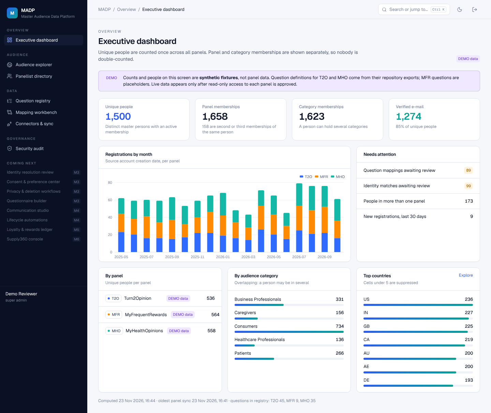

# MADP — Master Audience Data Platform

MADP brings Turn2Opinion (T2O), MyFrequentRewards (MFR) and MyHealthOpinions (MHO) into one audience platform. It
keeps one global person id while preserving each panel's own identity, brand, consent, rewards and provenance.

> **Status: Milestone 1.** Everything runs locally on clearly labelled **DEMO** data. No panel has been connected live
> yet, because live read-only access needs approval and scoped credentials. See `docs/PROGRESS.md` and
> `docs/THREE_PANEL_ACCEPTANCE_MATRIX.md`.



## Quick start

Requirements: Node 26.13.1 LTS, pnpm 12.23.0 (`corepack enable`), Docker.

```bash
docker compose up -d postgres mongodb redis
cp .env.example .env            # generate local secrets as described in the file
pnpm install
pnpm build
pnpm db:migrate
pnpm db:seed:demo               # DEMO population for all three panels
MADP_ADMIN_PASSWORD='choose-a-long-password' \
  pnpm --filter @madp/api admin:create --email you@example.com --name "Your Name" --role super_admin
pnpm dev                        # API http://localhost:4000/api/v1 · admin http://localhost:3000
```

On first sign-in you enrol an authenticator app (TOTP), because MFA is required.

## Tests

```bash
pnpm typecheck
pnpm test                # unit and connector contract tests
pnpm test:integration    # API against real Postgres and Mongo (throwaway database per run)
```

## Documentation

| Doc                                      | What it covers                                                      |
| ---------------------------------------- | ------------------------------------------------------------------- |
| `docs/REPOSITORY_AUDIT_{T2O,MFR,MHO}.md` | Read-only audit of each panel                                       |
| `docs/INTEGRATION_GAP_ANALYSIS.md`       | What each panel supports and what MADP needs                        |
| `docs/CANONICAL_DATA_MODEL.md`           | ERD, store boundary, counting rules                                 |
| `docs/ARCHITECTURE.md`                   | Components, pipeline, connector modes                               |
| `docs/SECURITY_PRIVACY.md`               | Controls, the live-access approval process, panel findings          |
| `docs/API_CONTRACTS.md`                  | MADP API, panel endpoints used, proposed panel additions, Supply360 |
| `docs/IMPLEMENTATION_PLAN.md`            | Milestones M1–M6 and their gates                                    |
| `docs/TECHNOLOGY_VERSIONS.md`            | Pinned versions and why                                             |
| `docs/PROGRESS.md`                       | Done, tested, pending, blocked                                      |
| `docs/THREE_PANEL_ACCEPTANCE_MATRIX.md`  | Per-panel acceptance status                                         |
