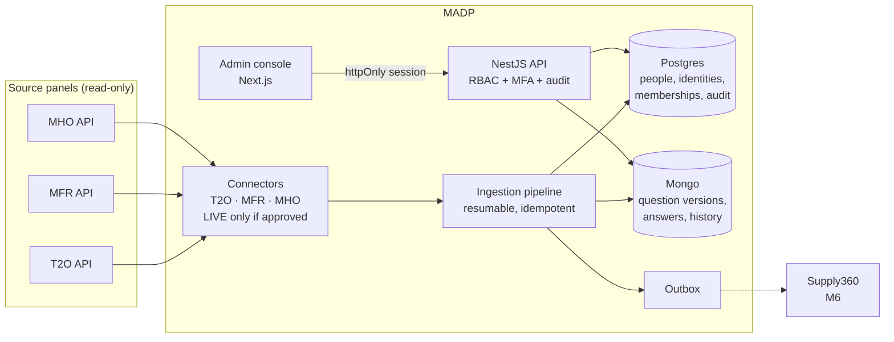

# Architecture

## 1. Shape
A pnpm and Turborepo monorepo. There is one API service and one admin web app, and shared packages hold the
contracts, configuration, connectors and test fixtures.

```
apps/
  api/      NestJS 12 REST API (/api/v1), Drizzle ORM on Postgres 18, MongoDB 8 driver
  admin/    Next.js 16 App Router admin console (React 19, Tailwind 4), server-side API calls only
packages/
  contracts/   zod schemas and types shared by API, admin and connectors (single source for OpenAPI)
  config/      validated environment loading (fails fast on missing or weak secrets)
  connectors/  one adapter per panel behind the PanelConnector interface, plus a DEMO connector
  testing/     DEMO population generator and source-sample fixtures (definitions only)
```



## 2. Request path
1. The admin console runs server components and server actions. The browser never sees the API token. It is held in
   an httpOnly, SameSite=Strict `madp_session` cookie and sent to the API from the Next.js server.
2. The API's global guard verifies the JWT (jose, HS256). It then checks the token's scope (`session` or
   `mfa_setup`) and the route's `@RequirePermissions`.
3. Controllers validate input with zod (`ZodPipe`). Responses use the shared contract types.
4. Reads of personal data write an `audit_event` row.

## 3. Ingestion pipeline (implemented, `apps/api/src/ingestion/ingestion.service.ts`)
`connector.health()` → questionnaires → questions, each stored as a version keyed by content hash
(`question_versions`) → a pending mapping row for every new version → options → respondents in pages of 200 →
identity resolution (source identity, master person, panel and category memberships) → answers (current values plus
`answer_history` on change) → checkpoint → outbox event `audience.counts.invalidated`.

- **Dry run:** counts only. Nothing is written except the `import_job` row.
- **Idempotent:** running it twice adds no rows (integration test `re-running an import is idempotent`).
- **Resumable:** the respondent cursor is checkpointed after every page.
- **Staging holds no PII:** `source_events` keeps an id, hash and type, not payloads.
- **Rate limiting and retry:** the HTTP connector spaces requests (250 ms by default), times out after 15 s, and retries 408, 425, 429, 5xx, timeouts and network errors up to 3 times with exponential backoff and full jitter. `Retry-After` is honoured, capped at 60 s. Refused access (401/403) and the panels' 404 error envelope are never retried.
- **Dead-letter queue:** an answer batch that still fails after retries is parked in `dead_letter` (source member ids and the error only, no answers or PII) and the import carries on. Refused access or a bad payload fails the job instead. Operators retry parked batches from the Connectors screen.
- **Reconciliation:** `GET /imports/:id/reconciliation` compares what the source returned with what MADP holds, with explicit pass/fail checks. A run is `reconciled` only when every check passes.

## 4. Connector modes
| Mode | When | What it reads |
|---|---|---|
| DEMO | default, and always in CI | `packages/testing` fixtures: real T2O and MHO question definitions taken from the repos, synthetic MFR definitions, generated people (`demo-…`, `@example.invalid`) |
| LIVE | panel in `LIVE_SOURCE_APPROVED_PANELS`, URL and token set, URL host equals `tenantHost` | the audited endpoints in `http-connector.ts` |

The LIVE connector is covered by contract tests against an HTTP stub that copies each panel's audited routes and
envelope (`packages/connectors/src/connectors.test.ts`). It has **not** run against a real panel.

## 5. Identity resolution
- An exact match on the keyed e-mail hash where **both** e-mails are verified links automatically to the existing
  person.
- Any other match (for example the same hash with one side unverified) creates a new person plus a pending
  `identity_match_candidate`.
- Merging is never automatic beyond that rule. Merge review and unmerge come in M3.

## 6. Deployment (local today)
- `docker compose up -d postgres mongodb redis` starts the data services. `docker compose --profile app up` adds the API
  and admin images.
- CI (`.github/workflows/ci.yml`) runs build, typecheck, unit and integration tests with Postgres and Mongo service
  containers.
- No staging or production environment exists, and nothing has been deployed. That needs approval (spec §15).

## 7. Scale notes
Keyset pagination on the panellist list, indexes on `(data_mode, country)`, `(data_mode, email_hash)` and the
membership keys, and counts computed in SQL. Materialised count tables, a Redis cache and BullMQ workers for
backfills are planned for M2 and M3, once real volumes are known. Redis is provisioned in compose but not used yet.
