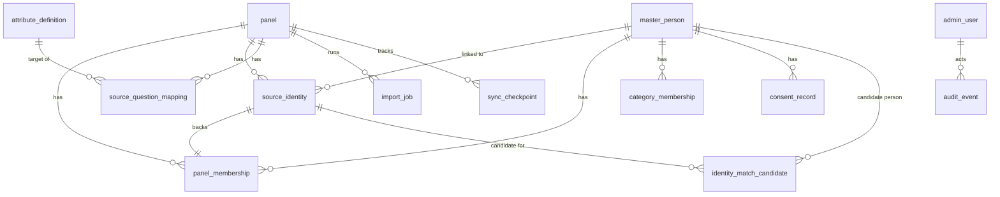

# Canonical data model

Source of truth: `apps/api/src/db/schema.ts` (Postgres, Drizzle) and `apps/api/src/mongo/mongo.ts` (MongoDB).
Migrations: `apps/api/drizzle/0000_init.sql` and `0001_audit_append_only.sql`.
Legend: **Implemented** (in schema and tested), **Planned** (designed here, milestone noted).

## 1. Store boundary

| Store | Holds | Why |
|---|---|---|
| PostgreSQL 18 | People, identities, memberships, categories, consent, attribute definitions, mappings, jobs, checkpoints, inbox/outbox, admin users, audit | Relational integrity, uniqueness for de-duplication, transactional counts, row-level audit |
| MongoDB 8 | `source_events` (immutable raw source references, no PII), `question_versions`, `profile_answers` (current), `answer_history` | Flexible per-panel question shapes, multi-select arrays, version history at high volume |

Cross-store writes are not transactional. Ingestion writes Mongo first (idempotent upserts keyed by
`panel + sourceQuestionId + contentHash` or `panel + sourceUserId + question`), then Postgres in a transaction, then the
checkpoint. A crash between steps is repaired by re-running the import, which is idempotent (tested).

## 2. Entity relationship diagram (implemented tables)

| Table | Key columns | Notes |
|---|---|---|
| `panel` | `code` (T2O/MFR/MHO), `name`, `sensitive` | Seeded; MHO is `sensitive=true` |
| `master_person` | `id` (uuid), `data_mode`, `country`, `state`, `city`, `birth_year`, `gender`, `status` | One global person; no direct PII |
| `source_identity` | `panel`, `source_member_id` (unique per mode and panel), `master_person_id`, `source_category`, `email_hash` (HMAC), `email_enc`, `email_masked`, `phone_enc`, `first_name_enc`, `last_name_enc`, `date_of_birth_enc`, `source_active` | One row per panel account. PII is AES-256-GCM encrypted per field |
| `panel_membership` | `master_person_id`, `panel`, `source_identity_id`, `status`, `joined_at` | Separate per panel; never merged |
| `category_membership` | `master_person_id`, `category`, `panel`, `basis`, `is_minor` | Unique per person, category and panel; a person may hold several |
| `identity_match_candidate` | `source_identity_id`, `candidate_person_id`, `rule`, `status`, `decided_by` | Ambiguous matches wait for review |
| `consent_record` | `master_person_id`, `panel`, `purpose`, `channel`, `status`, `evidence`, `captured_at` | Table exists; filling it from sources is M3 |
| `attribute_definition` | `key`, `label`, `dimension`, `value_type`, `sensitivity` | Seeded from `SEED_ATTRIBUTES` |
| `source_question_mapping` | `panel`, `source_question_id`, `question_version`, `suggested_attribute_key`, `suggestion_basis`, `attribute_key`, `status`, `value_map`, `decided_by` | Suggestions always start `pending` |
| `import_job` | `panel`, `kind`, `dry_run`, `status`, `counts`, `error`, `requested_by` | Reconciliation counts per run |
| `dead_letter` | `panel`, `import_job_id`, `stream`, `source_member_ids`, `error_kind`, `error`, `attempts`, `status` (open/resolved) | Answer batches that failed after retries. Resolved, never deleted |
| `sync_checkpoint` | `panel`, `stream`, `cursor`, `last_success_at`, `last_job_id` | Resume point and freshness |
| `webhook_inbox` | `panel`, `idempotency_key` (unique), `event_type`, `signature_valid`, `payload_ref` | Replay protection; no panel sends events yet |
| `outbox` | `topic`, `payload`, `published_at` | Downstream refresh events |
| `admin_user` | `email`, `password_hash` (argon2id), `role`, `totp_secret_enc`, `mfa_enabled`, `failed_attempts`, `locked_until` | MFA enforced |
| `audit_event` | `at`, `actor_id`, `actor_type`, `action`, `target_type`, `target_id`, `outcome`, `metadata`, `ip` | Append-only, enforced by a trigger |

Every row that can hold panel data has `data_mode` (`demo` or `live`), and the unique keys include it. Every count
filters on one mode, and the UI shows a DEMO badge.

## 3. Counting rules (implemented in `apps/api/src/audience/audience.service.ts`)
- **Unique people:** `count(distinct master_person_id)` over active memberships that match the filter.
- **Panel memberships:** `count(*)` of active memberships. A person in two panels counts twice here and once above.
- **Category memberships:** counted separately and never added into unique people.
- **Suppression:** any cell below `MIN_CELL_SIZE` (default 5) returns `value: null, suppressed: true`.
- **Freshness:** every response has `computedAt`, `freshestSourceSyncAt` and `oldestSourceSyncAt` from `sync_checkpoint`.
- **Filters:** panels, categories, countries, verified e-mail and canonical attributes.
- **Attribute filters:** a person matches when an answer to an **approved** mapping of that attribute holds one of
  the canonical values (after the mapping's value map). Mappings are approved per question version, so a new
  version must be reviewed before its answers count. Pending suggestions never affect counts. Filters are ANDed;
  values within one filter are ORed. Special-category attributes need `health.sensitive.read`, and each use is
  audited. The matching person set is passed to SQL as one array; a materialised attribute read model replaces
  that in M3 for large volumes.

## 4. Planned entities (spec §13), by milestone

| Entity | Milestone |
|---|---|
| `question_definition`/`version` as Postgres read model (Mongo is the store today) | M2 |
| `verification_evidence`, `mapping_review` history table, merge/unmerge log | M3 |
| `survey_participation` | M3 |
| `communication_campaign`, `template_version`, `communication_event`, `automation_definition`/`run`, `fatigue_policy` | M4 |
| `loyalty_account`, `reward_ledger` (per panel, append-only) | M5 |
| `service_client` (Supply360 and others), role/permission tables (today in code) | M6 |

## 5. Source precedence and freshness
- Field ownership: the source panel owns its own answers. When two panels disagree about a shared attribute (for example
  country), MADP keeps both with provenance and resolves by a per-attribute rule (most recent verified, then most recent).
  The rule engine is M3; today both values are stored.
- Freshness: every count response carries `generatedAt` and per-panel `lastSyncAt` from `sync_checkpoint`.
- Retention: `audit_event` is never deleted by application code. PII deletion (M3) will null encrypted fields and keep
  the audit trail.
